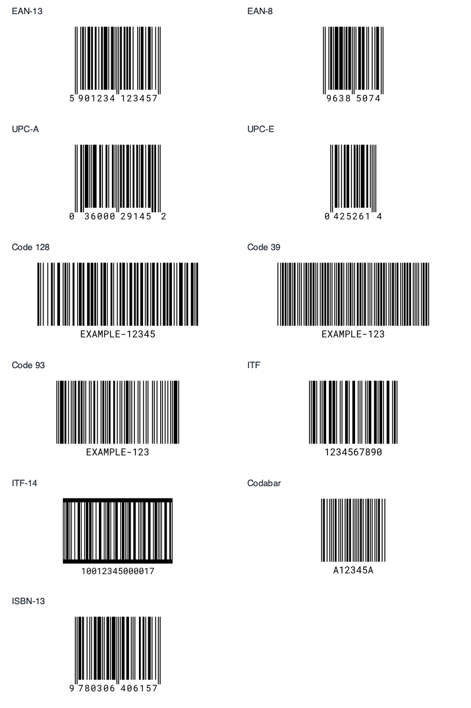

# VectorCraft Barcode Plugin

Generate common one-dimensional barcodes as editable vector artwork directly in your open VectorCraft document. Works entirely offline, including the optional human-readable text: labels are font outlines, not raster images or font-dependent text objects.

**[Download the plugin](https://github.com/breakerh/vectorcraft-barcode/releases/latest/download/vectorcraft-barcode.wasm)** · [Releases](https://github.com/breakerh/vectorcraft-barcode/releases) · [QR code companion plugin](https://github.com/breakerh/vectorcraft-qr-code)



## Supported types

| Type | Accepted input | Check digit behavior |
| --- | --- | --- |
| EAN-13 | 12 or 13 digits | Calculate the 13th digit, or validate it when supplied |
| EAN-8 | 7 or 8 digits | Calculate the 8th digit, or validate it when supplied |
| UPC-A | 11 or 12 digits | Calculate the 12th digit, or validate it when supplied |
| UPC-E | 6, 7, or 8 digits | 6 payload digits imply number system 0; 7 include number system 0 or 1; 8 include the check digit. Check digit is based on expanded UPC-A |
| Code 128 | Printable ASCII (space through `~`) | Required symbol checksum is automatic; even-length numeric data uses the compact C character set, otherwise B |
| Code 39 | Uppercase A–Z, digits, space, and `- . $ / + %` | No optional Mod-43 checksum is added; start/stop symbols are automatic |
| Code 93 | Uppercase A–Z, digits, space, and `- . $ / + %` | Required C and K checksums are automatic |
| ITF (Interleaved 2 of 5) | An even number of digits, at least 2 | No check digit is added automatically |
| ITF-14 | 13 or 14 digits | Calculate the 14th digit, or validate it when supplied; horizontal bearer bars are included |
| Codabar | Digits and `- $ : / . +`, optionally enclosed in A–D start/stop characters | Omit both start/stop characters to use `A…A`; no optional application checksum |
| ISBN-13 | 12 or 13 digits, starting with 978 or 979 | Calculate the 13th digit, or validate it when supplied |

Input is validated before artwork is changed. Incorrect check digits are rejected rather than silently replaced. Digits-only formats do not accept spaces or hyphens; Code 39 and Code 93 do not silently convert lowercase to uppercase. For Code 128, leading/trailing spaces are preserved. All input is limited to 80 ASCII characters to keep linear barcodes manageable.

UPC-E validates the zero-suppression rules. Scanners may report its expanded UPC-A/EAN-13 value rather than the eight printed digits. Likewise, UPC-A can be returned as an EAN-13 value with a leading zero.

## Install

1. Download **vectorcraft-barcode.wasm** from the link above.
2. In VectorCraft, choose **Object → Plug-ins → Install Plug-in…**, then select the file. **File → Open** also installs a WASM plugin.
3. Accept the larger computation budget prompt. This supports longer barcodes with detailed outlined labels. Computation stays local and can be cancelled.

Use the installation command rather than an Additional Plug-ins Folder, which skips plugins requiring the larger budget. Rust is only needed to build from source.

The plugin uses VectorCraft plug-in ABI v1 with string parameters and the heavy computation budget. Installation was checked with VectorCraft 0.18.0. Older hosts without these capabilities may not support it.

## Use

1. Open a document and preferably deselect existing artwork.
2. Choose **Object → Plug-ins → Generate Barcode…**.
3. Choose a barcode type and enter the data. For example, use `EXAMPLE-12345` with Code 128, or `590123412345` with EAN-13.
4. Set the **Narrow bar width** in millimeters (default 0.33 mm) and **Bar height** (default 23 mm).
5. Choose whether to include outlined text and a white background, then click **OK**.

The plugin centers the new artwork on the artboard. It creates a black bar path, an optional black text-outline path, and an optional white background. Group the new objects to move or scale them together. One Undo reverses the insertion.

Existing selected objects are preserved; VectorCraft may keep them selected along with the generated barcode. Running the plugin again adds another barcode rather than editing the previous one.

The overall width depends on the symbology, data length, and narrow bar width. Horizontal quiet zones are at least 11 modules and 6.5 mm per side; top and bottom margins are included. Keep these areas clear when disabling the white background. EAN/UPC/ISBN use extended guard bars and positioned digits when text is enabled. ITF-14 includes top and bottom bearer bars.

## Print and format considerations

Scale proportionally and keep adequate contrast and quiet zones. A very long code may extend beyond a small artboard. Validate the actual printed result with the scanner and printing process that will be used; a successful screen scan does not establish print-quality certification.

This plugin draws supplied identifiers; it does not allocate product numbers. ISBN prefixes and check digits are checked, but ISBN assignment is not verified. GS1-128 application identifier parsing, GS1 DataBar, supplements, and 2D codes are outside this version. Use the companion plugin for QR codes.

## Build and test

```sh
rustup target add wasm32-unknown-unknown
cargo test --locked
cargo build --locked --release --target wasm32-unknown-unknown
```

Output: `target/wasm32-unknown-unknown/release/vectorcraft_barcode.wasm`.

To distribute it, copy that file to `vectorcraft-barcode.wasm` and update the checksum:

```sh
cp target/wasm32-unknown-unknown/release/vectorcraft_barcode.wasm vectorcraft-barcode.wasm
shasum -a 256 vectorcraft-barcode.wasm > SHA256SUMS
```

Independent WASM scan tests:

```sh
python -m pip install wasmtime pillow zxing-cpp
python tests/validate_wasm.py
```

To regenerate the checked-in scan report, add `--write-report`. To render and scan complete examples including the outlined labels:

```sh
python -m pip install cairosvg
python tests/render_examples.py
```

Validation includes:

- 10 Rust tests covering checksums, input restrictions, UPC-E expansion rules, preservation of existing objects, geometry, transparency, and printable ASCII label outlines.
- 54 independent ZXing scans of the actual WASM-generated vector bars, across all 11 types with and without labels, plus 15 invalid-input cases.
- 11 complete SVG renders, including label curves, independently scanned with ZXing.
- 65 runs under wasmi 2.0.0, including 80-character stress cases, within the heavy computation budget.
- No WASM host imports, filesystem access, or network access.

The JSON reports contain neutral examples only. Test fixtures are examples for encoding tests, not identifiers intended for product use.

## License and credits

Plugin source: [MIT](LICENSE). Dependency notices: [THIRD-PARTY-NOTICES.txt](THIRD-PARTY-NOTICES.txt).

Outlined labels use the bundled, unmodified [Roboto Mono](https://github.com/googlefonts/RobotoMono) font, distributed under its [SIL Open Font License](assets/OFL.txt). No font installation is required.

- [VectorCraft plug-in API](https://github.com/storytold/vectorcraft/blob/main/docs/plugins.md)
- [barcoders](https://github.com/buntine/barcoders) for the core encoders
- [ttf-parser](https://github.com/harfbuzz/ttf-parser) for font outlines
- [ZXing](https://github.com/zxing/zxing) and [Zint](https://github.com/zint/zint) as independent barcode references

UPC-E and Codabar are implemented locally. The Codabar encoder uses the standard start/stop patterns, avoiding a B/C pattern swap in barcoders 2.0.0.
